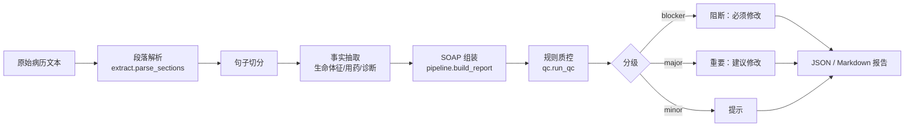

# 架构与设计取舍

## 目标 / 非目标

**目标**

- 把 `【段落】` 结构的中文门诊病历转成 SOAP JSON；
- 每个字段、每条问题都能回到原文字符区间；
- 规则可配置、可解释、可在内网离线运行。

**非目标**

- 不生成病历正文，不做诊断/处方建议；
- 不做术语归一（ICD/SNOMED）与 FHIR 导出（路线图）；
- 不替代医生签字与病案质控员判断。

## 数据流

## 模块职责

| 模块 | 职责 | 关键设计 |
| --- | --- | --- |
| `extract.py` | 段落、句子、生命体征、用药、诊断抽取 | 所有事实保留 `span`；诊断支持“1. 2.”编号切分；“待查/？”标记 `uncertain` |
| `qc.py` | 11 条规则 | 规则是纯函数 `Record -> [Finding]`，无隐藏状态；阈值集中在文件顶部 |
| `pipeline.py` | SOAP 组装、JSON/Markdown 渲染 | `summary` 统一给出 blocker/major/minor 与 verdict |
| `cli.py` | 命令行入口 | 支持文件 / 直接文本，便于嵌入 HIS 或批处理 |

## 三个关键决定

### 1. 只做抽取，不做补写

生成式模型最危险的失败是“把讨论过的检查写成已执行”。clinote 的字段只来自原文匹配，匹配不到就是未记录；这会让报告看起来“不完整”，但医生能信任它。

### 2. span 是原文字符区间，不是句子 ID

前端要高亮、质控员要核对，字符区间最直接。实现上 `Record.text` 保留完整原文，`_locate` 用 `text.find` 定位，避免多段拼接导致偏移。

### 3. 规则与模型解耦

规则先跑，模型只能作为“措辞润色层”，且必须锁定字段与数值。这样单测可以在毫秒级跑完，医院内网也不需要模型服务。

## 失败模式与处理

| 失败 | 表现 | 当前处理 |
| --- | --- | --- |
| 无 `【段落】` 标记 | 段落解析为空，R001 大量报错 | 明确提示先做段落对齐；不猜测结构 |
| 否定症状 | “无胸痛”被当成胸痛 | 否定词前缀过滤（R002），有回归测试 |
| 单位不统一 | `mmHg` / `kpa`、`℃` / `°F` | 当前只识别常见单位；未知单位不转换为数值 |
| 诊断编号混排 | “1. A 2. B” 被当成一条 | 正则按编号/分号切分 |
| 既往用药混入本次 | “平时吃氨氯地平”算成本次医嘱 | 既往史单独解析为 `past_medications` |

## 扩展一个新规则

1. 在 `qc.py` 里写纯函数 `rule_xxx(record) -> list[Finding]`；
2. 用 `_finding(...)` 统一填 `rule_id / severity / title / message / suggestion / evidence`；
3. 把函数加入 `RULES` 列表；
4. 在 `tests/test_clinote.py` 加“命中”和“不命中”两个用例；
5. 在 README 规则表补一行。

## 性能

纯标准库、单份病历毫秒级；瓶颈在规则数量而不是文本长度。批量处理建议按文件并行，规则本身无共享状态。
